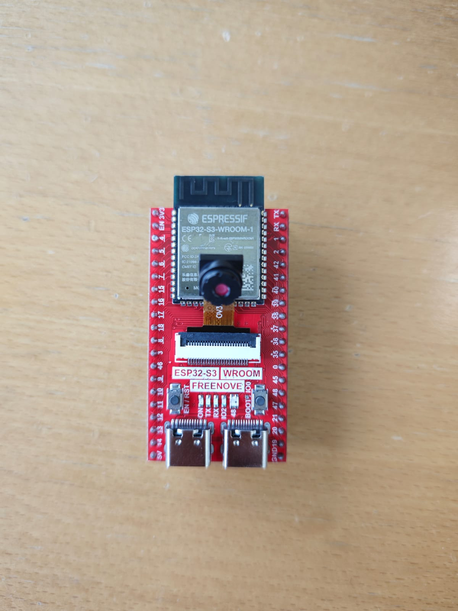

# ESP32-S3 Camera Telegram Bot


Take pictures with an ESP32-S3 camera board by sending a command to a Telegram bot.

Built with ESP-IDF as a hands-on project to learn the framework, FreeRTOS tasks, and HTTP(S) communication over TCP/IP.

 

## Features

- `/photo` in Telegram captures a JPEG and sends it back to your chat
- Local web server with a single snapshot (`/jpg`) and a live MJPEG stream (`/stream`)
- HTTPS with certificate verification via the ESP-IDF certificate bundle

## How it works

The board cannot be reached from the internet, so it contacts Telegram instead:

1. A FreeRTOS task long-polls the Bot API (`getUpdates`) for new messages.
2. When a `/photo` command arrives, the camera captures a frame.
3. The frame is uploaded to your chat via `sendPhoto` as a multipart form.

## Hardware

- ESP32-S3-WROOM camera board with octal PSRAM
- USB cable for flashing

Other boards are supported by selecting the matching pin layout in `main/camera_pinout.h`.

## Getting started

### Requirements

- ESP-IDF v6.0
- A Telegram bot token from [@BotFather](https://t.me/BotFather)

### Configuration

Create `main/personal.h`:

```c
#ifndef PERSONAL_H
#define PERSONAL_H

#define WIFI_SSID    "your-ssid"
#define WIFI_PASS    "your-password"
#define TG_BOT_TOKEN "123456:ABC-your-token"
#define TG_CHAT_ID   "123456789"

#endif
```

To find your chat ID, send any message to your bot and open
`https://api.telegram.org/bot<TOKEN>/getUpdates`. The value is under `message.chat.id`.

### Build and flash

```sh
idf.py build
idf.py -p <PORT> flash monitor
```

The project uses the "Single factory app (large)" partition table, since the HTTPS stack does not fit in the default 1 MB app partition.

## Usage

| Where | Action | Result |
|---|---|---|
| Telegram | Send `/photo` to the bot | A photo arrives in your chat |
| Browser | `http://<esp-ip>/jpg` | Single snapshot |
| Browser | `http://<esp-ip>/stream` | Live stream |

The device IP is printed in the serial monitor after connecting to Wi-Fi.

## Project structure

```
main/
├── main.c             Startup: camera, Wi-Fi, web server, Telegram task
├── camera_manager.c   Camera configuration and initialization
├── camera_pinout.h    Pin layouts for supported boards
├── wifi_manager.c     Wi-Fi station connection
├── http_server.c      Local /jpg and /stream endpoints
├── telegram.c         Bot polling and photo upload
└── personal.h         Credentials (not committed)
```


